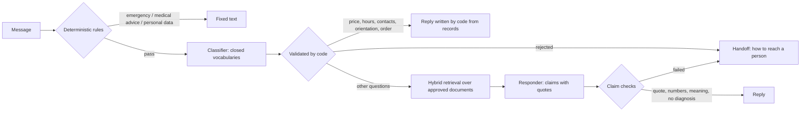

# frontdesk-agent

A messaging agent for small businesses. It answers customers from information the business has approved, never gives medical advice, and hands the conversation to a person when one is needed. Each business runs as its own deployment from the same code. All data in this repository is synthetic.

The code is one conversation engine. Channels connect to it through adapters ([ADR-0010](docs/adr/0010-one-engine-channel-adapters.md)); no channel is connected yet, so today the engine is reached through a terminal chat and the evaluations.

## What it does

- Answers in Albanian, Italian or English, in the customer's language.
- Writes prices, opening hours, contacts and orientation in code from approved records, and an order's status in code from the shop's order data: no model words them, so they cannot be misstated.
- Answers other questions from approved documents found with hybrid retrieval (full text plus vectors, fused with Reciprocal Rank Fusion). Every sentence carries a quote from its passage, and code checks the quote, its numbers and its closeness in meaning before anything is sent.
- Clinics: points patients to the right service using a map the doctors approved, and never assesses symptoms.
- Shops: looks up an order's status from the order number and postal code written in the message, with a limited number of attempts per conversation.
- Recognises emergencies with rules, and with the classifier as a second net, and always answers them with an approved fixed text.
- Hands the conversation to a person for emergencies, medical questions, or anything it cannot ground in evidence. The reply says how to reach a person and never promises a call: notifying staff arrives with the first channel. A message with personal details, such as a phone number or an email address, gets a fixed privacy text instead: the details are never used.

## One engine, many channels

The engine takes a customer's text and a small conversation state that holds metadata only, and returns a reply. It knows nothing about any channel. A channel is an adapter: it verifies and receives messages, maps them to a business and a conversation, and sends the replies, with its own texts and limits. Each channel also has a policy that can switch the business's features off and never on. The adapter interface is built together with the first channel, Instagram (M4). A website chat in FAQ mode follows later as one more adapter with its own policy, not as a fork.

## How a message is handled



- The responder never sees the original message, only validated fields and document passages: it cannot discuss what it never receives.
- A model error, a timeout or any other failure also ends in the handoff text.
- Logs and traces carry metadata only by default.
- Design decisions are recorded in [`docs/adr`](docs/adr).

## Try it without any API key

Requires Docker and [uv](https://docs.astral.sh/uv/).

```bash
docker compose up -d --wait postgres
uv sync
uv run frontdesk db upgrade --env-file deploy/demo-clinic.env
uv run frontdesk knowledge bootstrap-demo --env-file deploy/demo-clinic.env
uv run frontdesk chat --env-file deploy/demo-clinic.env
```

Try `Sa kushton fizioterapia?`, `Ho mal di schiena, da chi devo andare?` and `Is there parking near the clinic?`. Type `exit` to leave, and `docker compose down` to stop the database (its data stays in a Docker volume).

The demo replaces the models with deterministic keyword stand-ins: it shows the pipeline (rules, validation, facts written by code, retrieval, claim checks, handoffs), not model quality. For real multilingual retrieval, install the local embedding model (`uv sync --extra demo`) and set `FRONTDESK_EMBEDDING_BACKEND=fastembed`, for bootstrapping and also for `chat` and `eval`: the active knowledge records which embedder computed its vectors, and a deployment with another one refuses to start until `frontdesk knowledge reembed` runs. The model's 0.22 GB are downloaded with the first bootstrap.

A second deployment, `deploy/demo-shop.env`, runs a shop with its own profile and order status, and without any clinic data or calendar. Run the same `db upgrade` and `bootstrap-demo` commands with that file, then chat and ask `Dov'è il mio ordine ORD-10427? CAP 20121`.

## Try it with the real model

The same demo chat can answer with Gemini on Vertex AI (EU) instead of the stand-ins. On top of Docker and uv it needs:

- the [Google Cloud CLI](https://cloud.google.com/sdk/docs/install) (`gcloud`), to sign in once;
- a Google Cloud project with Vertex AI enabled;
- the budget file of the M3 evaluation phase: `runs/budget.yaml` in the private repository frontdesk-mcu.

The budget file caps what live requests may cost, and every request the chat sends counts against it. It holds the cap in euros (`cap_eur`); the `ledger`, a file beside it where one line is written for each paid request and from which the spent amount is read; the `exchange_rate` that turns US dollars into euros; and the `prices` of each route, with the page and the date each was read from. The smallest file the chat accepts looks like this (the numbers only show the shape: the real file holds the current prices and rate):

```yaml
cap_eur: 10.00
ledger: spend.jsonl
exchange_rate:
  usd_per_eur: 1.06
  source: https://www.ecb.europa.eu/stats/eurofxref/eurofxref-daily.xml
  date: 2026-10-09
prices:
  source: https://cloud.google.com/vertex-ai/generative-ai/pricing
  retrieved: 2026-10-10
  routes:
    vertex-eu-gemini-flash-lite:
      unit: tokens_1m
      input_usd: 0.275
      output_usd: 1.65
```

Point `--budget` at that file itself, never at a copy: the ledger beside it is the one record of what M3 has spent.

Then, in this repository:

```bash
docker compose up -d --wait postgres
uv sync
uv run frontdesk db upgrade --env-file deploy/demo-clinic-live.env
uv run frontdesk knowledge bootstrap-demo --env-file deploy/demo-clinic-live.env
gcloud auth application-default login   # once
FRONTDESK_GCP_PROJECT=<project> uv run frontdesk chat --live \
  --budget <path to the M3 budget file> --env-file deploy/demo-clinic-live.env
```

`deploy/demo-clinic-live.env` and `deploy/demo-shop-live.env` are the demo files with the Gemini route; the shop takes the same commands with its own file. They keep the same databases and the same embedder, so knowledge loaded with the offline files still matches, and they do not name the project: it comes from `FRONTDESK_GCP_PROJECT` in your shell.

The line printed before the first prompt states two rules, and the program enforces what it can:

- **Every request is paid from the budget.** After each reply the chat prints `cost: <this turn> EUR · session <total> EUR · left <remaining> EUR`. When the budget has no room, Google keeps refusing with 429, or the ledger cannot be read or written, the chat shows what the turn that was cut short had cost, then `stopped: <reason>`, and exits with code 1. One live session or run holds the budget at a time: a second one is refused until the first has ended. `exit` or the end of input ends a session normally; Ctrl-C ends it at once, with exit code 130, and gives the budget back.
- **Test messages only.** Gemini is approved for evaluation data, not for patients' words, until Vertex AI's data retention for it is checked. Type made-up questions, never a real patient's data. The chat writes no transcript to disk: the ledger holds amounts, never message text.

Before the banner the chat checks what it can without spending, and each failure is one `error:` line that says what to do. It refuses to start while a proxy or certificate variable (`HTTP_PROXY`, `HTTPS_PROXY`, `ALL_PROXY`, `SSL_CERT_FILE`, `SSL_CERT_DIR`, `REQUESTS_CA_BUNDLE`, `CURL_CA_BUNDLE`) or `GOOGLE_CLOUD_QUOTA_PROJECT` is set in the shell: unset it for the session. It sends one free `CountTokens` request, which proves your credentials, the API and the model at the pinned endpoint, and it appends a line of zero dollars to the ledger (`"kind": "preflight"`), which proves that the first paid request can be counted. `frontdesk eval turns --live` makes the same checks before it runs the labelled cases.

If a reply is the hand-off text and a `model error: <Type>` line came just before it, the model request failed. `DefaultCredentialsError` or `RefreshError`: run `gcloud auth application-default login`. `ModelHTTPError`: Google refused the request (a wrong project, no permission, or Vertex AI not enabled for the project). `ConnectError`: no network (the chat retries for about 14 s first). `OperationalError`: the database stopped. A hand-off that took 45 s, with `rule=timeout` in the trace and no such line, means the request did not answer in time.

## Evaluation

- `uv run frontdesk eval turns --env-file deploy/demo-clinic.env`: labelled messages and short conversations, 79 cases over the two demo businesses (56 for the clinic, 23 for the shop), including zero-tolerance suites for medical advice, personal data, data access and prompt injection. CI runs them for both demo businesses, together with a suite of plausible but wrong answers that must never reach a person.
- `uv run frontdesk eval retrieval --env-file deploy/demo-clinic.env`: recall@k and MRR per question, language and tag (cross-lingual, no diacritics, paraphrase). It exits 1 instead of reporting zeros when the business has no active knowledge or a question names a document that does not exist.

Offline runs check contracts and fallbacks. Runs with real models are recorded in [`docs/evals`](docs/evals).

Live runs (`frontdesk eval turns --live --route <route> --run-dir <dir> --budget <file> --env-file <file>`) use the same cases on a route approved for evaluation data. They start only after the checks of `chat --live` (no proxy, certificate or billing-project variable in the shell, a free request that proves the credentials, the API and the model, a ledger that takes a line) and a plan that shows the most the run could cost, which you confirm or skip with `--yes`. They reserve each request against the budget file's cap, hold the budget so that no other live run, chat or experiment spends from it meanwhile, record every turn in the run directory, and resume there after a stop (`--limit N` runs only N cases at a time). They write `report.md` and `report.json`, with a report per language and the criteria of the phase, and `review.html`, a page for the cases a person must judge; the page saves `labels.yaml`, and `frontdesk eval report --run-dir <dir>` recomputes the reports with the reviewer's labels. A live run exits 0 when it is done, 1 on an error, 3 when Google's rate limit stopped it, 4 when the budget has no room, 5 when the model keeps failing, and 130 on Ctrl-C; after a stop the same command resumes. They are launched by hand from the private configuration repository, never in CI.

`frontdesk eval embedders --env-file <file> --cases <retrieval cases> --run-dir <dir> --budget <file> --candidate <route> [--candidate <route>]` compares embedding models on the retrieval cases in a scratch database, whose name must end in `_experiment`: create it empty (`createdb frontdesk_mcu_experiment`) and the command migrates it, as its owner, after asking the server which database the URL reaches and refusing any other. The reference is the demo's local model (`FRONTDESK_EMBEDDING_BACKEND=fastembed`); the candidates are Vertex AI routes on `europe-west1` approved for evaluation data (`vertex-ew1-text-multilingual-embedding-002`, `vertex-ew1-gemini-embedding-001`). Each embedder indexes the pack's active knowledge in a table of its own dimension, and the production hybrid search answers every question with it. The report gives recall@1, @3 and @5 and MRR per language, the time and cost of indexing and of questions, and the decision of the rule in [ADR-0005](docs/adr/0005-embeddings-chosen-by-evaluation.md). It is metered against the same budget file, which must price each candidate route per 1,000 characters (`unit: characters_1k`; a text is counted at the larger of the characters Vertex AI reports and its UTF-8 bytes), and it proves that the ledger takes a line before the first paid text. It saves the results of each embedder and resumes with the next one after a stop. Each stop it expects ends in one `error:` line and exit code 1 (an expired login, an API that is not enabled, a model not served at the pinned host, no network, the budget, a rate limit, a file it cannot use), or in `stopped:` and exit code 130 for Ctrl-C; the results saved so far are kept, and the same command resumes.

## Roadmap

| Phase | Scope | Status |
|---|---|---|
| M0 | Repository, CI, local stack, decision records | Done |
| M1 | Business packs, approved versioned knowledge, hybrid retrieval, retrieval evaluation | Done |
| M2 | Safety rules, classifier, replies written from records, document answers with checked quotes, offline evaluations, keyless demo with two deployments | Done |
| M3 | Live model on Vertex AI in the EU, chosen by evaluation (today Gemini 3.1 Flash-Lite), with a small set of approved clinic information; the evaluations also run live, within a budget, and the claim checks are tuned by measurement | Done |
| M4 | Instagram in shadow mode: the first channel adapter and its policy; the agent proposes replies and staff approve each one before it is sent | Planned |
| M5 | Limited FAQ release in production, without bookings | Planned |
| M6 | Bookings and WhatsApp | Planned |
| M7 | Gradual rollout | Planned |
| Web | Website chat in FAQ mode, as one more channel adapter | Planned |

## Development

```bash
uv sync --all-groups
uv run ruff check .
uv run ruff format --check .
uv run mypy
uv run lint-imports
uv run pytest
uv run pytest --cov   # branch coverage of src/frontdesk; fails under 80%
```

Tests start Postgres with testcontainers (Docker required).

`docker build -t frontdesk:local .` builds the container image of the HTTP service. It serves `/health` today; channel webhooks arrive with the first channel.

## License

MIT
